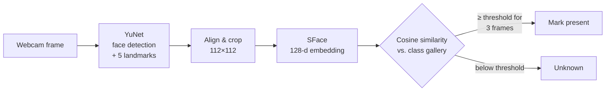

<p align="center"></p>

<h1 align="center">FaceRoll</h1>
<p align="center"><b>Face recognition attendance for the classroom. A Windows desktop app that runs offline on a laptop webcam.</b></p>
<p align="center">Developed by <b>Malak Zubair</b>, Assistant Professor, G.C.M.S Timergara</p>

---

Taking a paper roll call in a class of 40 eats several minutes of every lecture. With FaceRoll, students walk past or sit in front of the laptop webcam. Each recognised face is marked present on the roster, and the register is ready to export to Excel when the class ends.

Everything runs on the local machine. There is no cloud service, no account and no GPU requirement, and the face models ship inside the repo.

## Features

- **Webcam enrolment.** The app captures 10 varied face samples per student (configurable). It rejects near-duplicate frames and prompts the student to turn their head.
- **Bulk import from photos.** Point it at a folder of `12_Ali Khan.jpg` files, or at sub-folders like `12_Ali Khan/` holding several photos each.
- **Live multi-face attendance.** Several faces can be recognised in one frame. A student is marked only after 3 consecutive frames agree, and a small IoU tracker re-checks a confirmed face every 12 frames instead of on every frame, so a crowded frame stays responsive on CPU.
- **Manual override.** Double-click to mark someone present or absent. If you mark a student absent by hand, the camera will not mark them present again in that session.
- **Duplicate check.** At enrolment the app warns you if the new face already matches another student in the class.
- **Records.** A students × sessions register with P/A cells and percentages. Students below a threshold you choose (default 75 %) are highlighted, and a mistaken cell can be corrected with a double-click.
- **Export.** Formatted `.xlsx` with colour-coded cells and frozen headers, or UTF-8 `.csv` that opens in Excel with Urdu names intact.
- **Multiple classes and sections.** Each class keeps its own roster and face gallery, so a student is only ever matched against their own class.
- **Back up and restore** the whole database to a single `.db` file.

## How it works



Every face is an L2-normalised 128-dimensional vector $\mathbf{e}$. Student $s$ has enrolled samples $\{\mathbf{g}_{s,1},\dots,\mathbf{g}_{s,n}\}$, and the face is scored against that student as

$$\text{score}(s) = \max_i \; \mathbf{e}^\top \mathbf{g}_{s,i}$$

The best-scoring student wins if the score reaches the match threshold (default **0.40**, a little above SFace's published 0.363, so the app says "Unknown" before it marks the wrong person). Taking the max over samples, rather than comparing with one averaged template, holds up better when pose and lighting change between enrolment and class.

| Component | Model | Size | Licence |
|---|---|---|---|
| Detector | [YuNet](https://github.com/opencv/opencv_zoo/tree/main/models/face_detection_yunet) (2023) | 0.2 MB | MIT |
| Recogniser | [SFace](https://github.com/opencv/opencv_zoo/tree/main/models/face_recognition_sface) (2021) | 37 MB | Apache-2.0 |

Both models run through OpenCV's DNN module, so the only heavy dependency is `opencv-python`. There is no dlib, no CMake and no Visual C++ build step.

## Install

### Option 1: download the app (no Python needed)
Get `FaceRoll-windows.zip` from the [Releases](../../releases) page, unzip it, and run `FaceRoll.exe`.

### Option 2: run from source
Requires Windows 10/11 and [Python 3.10+](https://www.python.org/downloads/windows/).

```bat
git clone https://github.com/Zubair-DLCS/Facial-recognition-attendane-system-.git
cd Facial-recognition-attendane-system-
run.bat
```

`run.bat` creates a virtual environment on first launch, installs the dependencies, and starts the app. If you prefer to do it by hand:

```bat
python -m venv .venv
.venv\Scripts\activate
pip install -r requirements.txt
python app.py
```

### Build your own .exe
```bat
build.bat
```
The output is `dist\FaceRoll\FaceRoll.exe`. Zip the `dist\FaceRoll` folder to copy it to another PC. Pushing a tag such as `v1.0.0` also triggers the GitHub Actions workflow, which builds the zip and attaches it to the release.

## Using it in class

1. **Students tab → New class.** For example, *BS CS 3rd Semester – A*.
2. **Enroll tab.** Enter the roll no and name, ask the student to look at the camera, and press **Start capture**. They slowly turn their head until 10 samples are taken. Then press **Save student**. This takes roughly 15 seconds per student. Alternatively, use **Students → Import from photos…**.
3. **Take Attendance tab.** Pick the class, give the session a title, and press **Start session**. Students come up to the laptop one or two at a time, or sit in its view. Names turn green with a `[P]` tag and a beep when marked.
4. **End session.** Anyone not marked counts as absent.
5. **Records tab.** Review the register, fix any cell, and click **Export Excel**.

**Getting good accuracy**

- Light the faces from the front. A bright window behind the students is the most common cause of "Unknown".
- Enrol in the same room as attendance where you can, and have students wear their glasses if they normally do.
- A 720p laptop webcam works reliably up to about 2–3 m. For a whole-room view, use an external USB camera and lower **Minimum face size** in Settings.
- If two students get confused, re-enrol both of them, or raise the **Match threshold** to 0.45.

## Settings

| Setting | Default | Effect |
|---|---|---|
| Match threshold | 0.40 | Higher means stricter: fewer wrong matches, more "Unknown" |
| Confirm frames | 3 | Consecutive agreeing frames needed before marking |
| Minimum face size | 36 px | Smaller faces are ignored. Lower this for distant students |
| Samples per student | 10 | Face samples captured at enrolment |
| Institution | — | Printed on the exported register |

## Privacy

Face embeddings are biometric data. FaceRoll stores them only in a local SQLite file (`%APPDATA%\FaceRoll\faceroll.db`) and never sends anything over the network. Before using it, tell students (or their parents) how the system works and get their consent. Delete a student's record when they leave the class. FaceRoll does not include liveness or anti-spoofing checks. Someone holding up a phone photo of a classmate could be marked present, so keep the camera where you can see it.

## Project structure

```
FaceRoll/
├── app.py                  # entry point
├── faceroll/
│   ├── engine.py           # YuNet + SFace wrapper, gallery matching
│   ├── camera.py           # capture thread, enrolment & attendance processors, tracker
│   ├── database.py         # SQLite schema and queries
│   ├── export.py           # Excel / CSV register
│   ├── paths.py            # model + data folder locations (source and frozen builds)
│   └── ui/                 # PySide6 tabs: attendance, enroll, students, records, settings
├── models/                 # bundled ONNX models (see models/README.md)
├── tests/                  # pytest, no webcam needed
├── run.bat · build.bat
└── .github/workflows/build.yml
```

Run the tests with `pip install -r requirements-dev.txt` followed by `python -m pytest -q`.

## Roadmap

- [ ] Blink or head-movement liveness check against photo spoofing
- [ ] Per-session PDF report
- [ ] Student-wise attendance history and charts
- [ ] Urdu interface

## Citation

```bibtex
@software{zubair_faceroll_2026,
  author = {Zubair, Malak},
  title  = {FaceRoll: Offline Face Recognition Attendance for Classrooms},
  year   = {2026},
  url    = {https://github.com/Zubair-DLCS/Facial-recognition-attendane-system-}
}
```

## Acknowledgements

YuNet and SFace by the [OpenCV Model Zoo](https://github.com/opencv/opencv_zoo) contributors. SFace: Zhong, Y. et al., *SFace: Sigmoid-Constrained Hypersphere Loss for Robust Face Recognition*, IEEE TIP, 2021.

## License

MIT © 2026 Malak Zubair. The bundled models keep their own licences (MIT and Apache-2.0).
